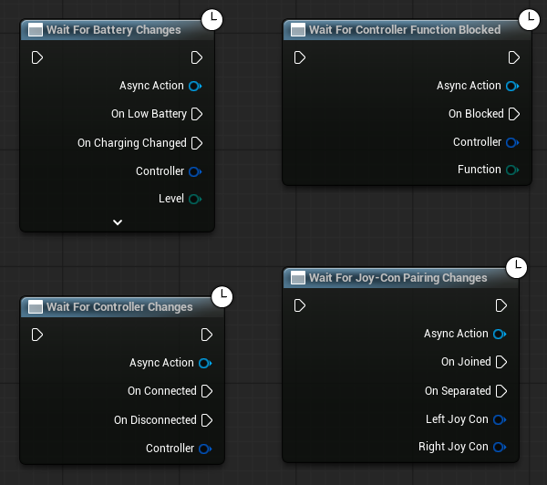

# Reacting to controllers

Controllers finish enumerating on a background thread, at a moment nothing in the game controls: in the
editor they are usually ready before the level loads, in a packaged game they usually are not, and a
Bluetooth controller may arrive minutes in. Code that only handles "already connected" works on the
machine it was written on and nowhere else.

## The Wait For… nodes

Each is a single latent node whose event pins carry their payload as ordinary data pins — no Create
Event, no Bind Event, no matching custom-event signatures.

| Node | Pins | What to know |
|---|---|---|
| **Wait For Controller Changes** | On Connected, On Disconnected | This plugin's controllers. On Connected fires at once for every controller already connected, then for each new one, so none can be missed. On Disconnected reports the last known identity and whether reports simply stopped |
| **Wait For Any Controller Changes** | On Connected, On Disconnected | **Every controller Unreal accepts**, Xbox and other XInput pads included. Use it to decide when a *player* joins or leaves. Keyboard and mouse are not reported: they are connected from the first frame, and announcing them would spawn a player before anyone touched anything |
| **Wait For Joy-Con Pairing Changes** | On Joined, On Separated | Both halves' identities, already carrying the new grip, partner and player. Not replayed — joins are actions, not state — so read **JSL4U Get Connected Controllers** for the current pairing at start-up |
| **Wait For Battery Changes** | On Low Battery, On Charging Changed | See [Battery](#battery) |
| **Wait For Controller Function Blocked** | On Blocked | See [Conflicts with other applications](output.md#conflicts-with-other-applications) |

Both connection nodes report the same `FJSL4UControllerInfo`; `bIsJoyShockController` says which kind
arrived, and a controller the plugin does not drive reports its own hardware's capability flags — false
for the gyro it lacks, true for the rumble it has. You rarely need to ask: every node takes the payload's
`ConnectionId`, whichever kind it is.

Three things that go wrong:

- **Do not also loop over Get Connected Controllers.** On Connected already replays, so a `For Each`
  alongside it handles every existing controller twice.
- **Cancel the node when its widget goes away.** Each node's `Async Action` output accepts **Cancel**.
  `Remove From Parent` unbinds nothing, so a removed widget keeps running its handler against a
  half-dismantled state.
- **Subsystem delegates: bind from a `BeginPlay`.** The same events exist as assignable delegates on the
  **JoyShock Subsystem**, for C++ or for Blueprints that prefer binding. Get the subsystem from a
  `BeginPlay`, not from a Game Instance's `Init`: subsystems are created at the very end of `Init`, and
  the events would silently never fire.

## Identities

| Field | What it is |
|---|---|
| `ConnectionId` | Names the controller, and is the only address the plugin's nodes take. Not reused during the run, and it exists for every controller Unreal accepts — positive for one this plugin drives, negative for one it does not. The key for maps of spawned Pawns or handled connections |
| `InputDeviceId`, `PlatformUserId` | Unreal's native identities, as integers for Blueprint. `InputDeviceId` names one physical connection |
| `HardwareDeviceIdentifier` | The model's stable name — see [Model identifiers](#model-identifiers) |

Do not keep `InputDeviceId` or `ConnectionId` between game runs.

## One address, honest answers

Every per-controller node takes a `ConnectionId` and accepts one for **any** controller, including the
Xbox pads this plugin does not drive. A game does not branch on whose controller it holds; it asks for what
it wants, and the answer is the truth about that hardware:

| Asking for | On hardware without it |
|---|---|
| A reading — **Get IMU State**, **Get Motion State**, **Get Touch State** and the like | Zeroes. Check `Has Motion Sensors` / `Has Touchpad` before believing, or offering, a reading of zero |
| Rumble | Works on every pad: over HID for one of ours, through Unreal's force-feedback channels for a foreign one. On a foreign pad *assigned to a player*, the engine rewrites those channels every frame, so a direct value lasts about a frame; on an unassigned one it stands. For rumble during play, use Force Feedback |
| Anything else — gyro calibration, light colour, player indicator, HOME light | Nothing happens, and one warning names the node and the connection. One per controller per node, so a node in a Tick cannot bury the log |

A stored `ConnectionId` whose controller has been unplugged resolves to nothing: the call fails or does
nothing rather than landing on whichever controller connected next.

## Battery

**Battery Level** and **Is Charging** are on every controller info. **Wait For Battery Changes** turns them
into events: On Low Battery fires once per episode and re-arms when the controller is charged or plugged
in, and On Charging Changed reports the cable or dock going in and out.

| Value | Meaning |
|---|---|
| **Battery Level** | `Empty`, `Critical`, `Low`, `Medium` or `Full`. Coarse on purpose: a Switch 1 controller reports only five states, so a percentage there would be invented precision. `Unknown` means the controller does not report charge, and is never a low battery |
| **Battery Percent** | Filled by the PlayStation and Switch 2 controllers, `-1` elsewhere. For display, not decisions |

A Switch 2 controller reports its cell's **voltage**, not its charge, so its percentage is a straight line
between 3.0 V empty and 4.2 V full, where the real discharge curve is not straight — and voltage sags
under load, so it reads lower mid-rumble than at rest. Drive a bar from it, not a number. The voltage
itself is on **JSL4U Get Switch 2 Sensors**.

## Model identifiers

Every connection is registered with Unreal's `FInputDeviceRegistry`, with the same `Config/Input.ini`
hardware metadata the engine's own XInput and WinDualShock plugins use. `UInputDeviceSubsystem` therefore
sees these as standard **Gamepad** devices with stable identifiers:

| Identifier | Controller |
|---|---|
| `DualShock4`, `DualSense` | PlayStation |
| `JoyConLeft`, `JoyConRight` | Joy-Con halves |
| `JoyCon2Left`, `JoyCon2Right` | Joy-Con 2 halves |
| `SwitchProController`, `Switch2ProController` | Pro Controller, Pro Controller 2 |
| `JoyShockGamepad` | Fallback for a controller the plugin cannot identify |

Identify hardware by this identifier, never by parsing the display name.
