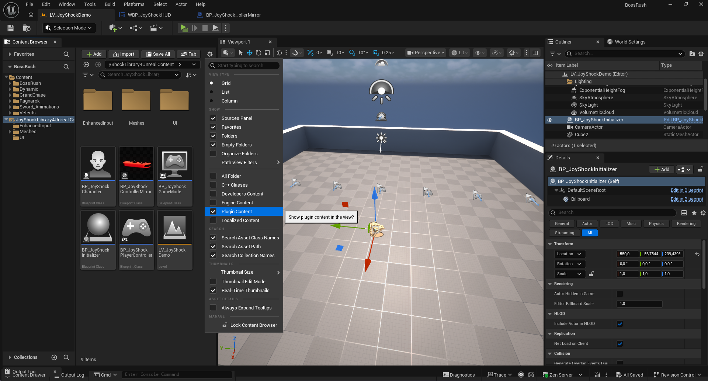
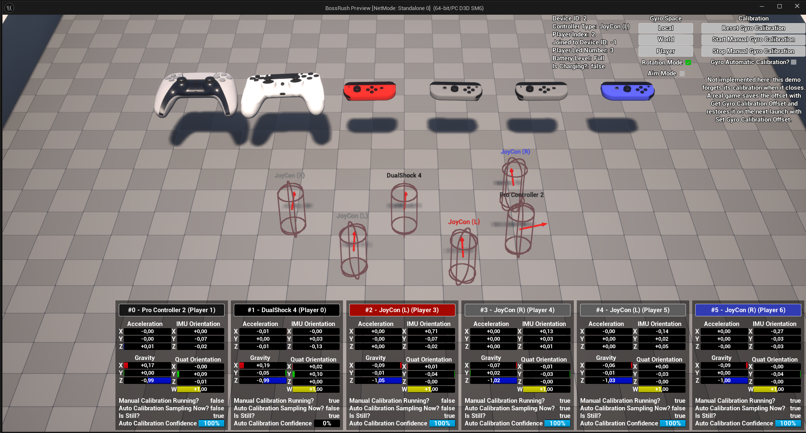
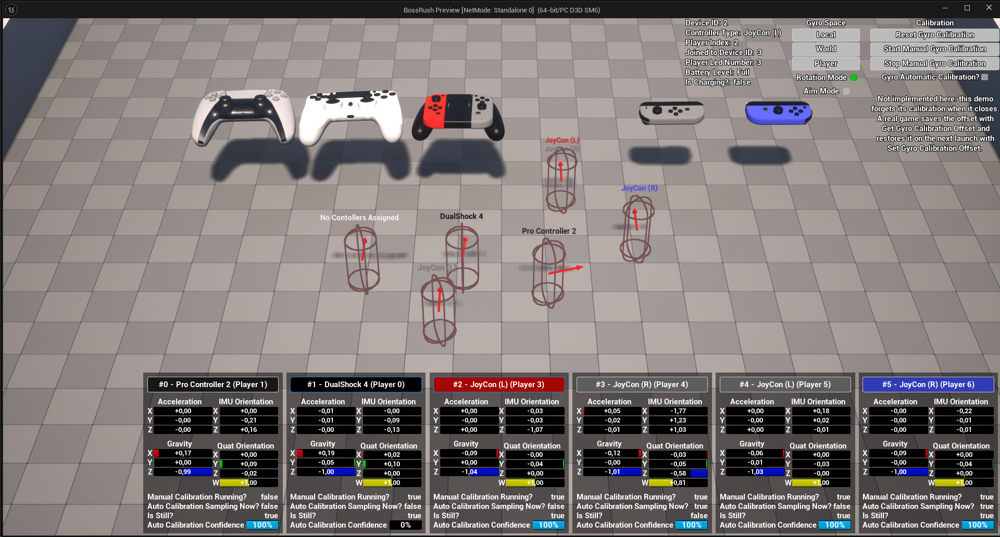

# Demo level

The plugin ships a demo level, `LV_JoyShockDemo`, in its Content folder. To see it in the Content Browser,
enable **Show Plugin Content** in the Content Browser's settings:

## What it does

Connect one or more controllers and press Play. Every controller gets its own Local Player,
PlayerController and Character, and moves it with its left stick — a small local-multiplayer example. It
runs in Standalone and in the editor's Play viewport alike.

The view stays on a fixed overview camera however many controllers are connected: the level's
`CameraActor` has **Auto Activate For Player** set to **Player 0**, so possessing a Character never moves
the view. That is Unreal's normal camera management, not a graph in the PlayerController.

Next to the players, each controller also gets a **mirror**: a 3D model that follows the controller's
measured orientation, so motion and axis conventions can be checked by eye. A HUD shows the motion and
controller readings and has calibration controls.

## How it is built

Each Blueprint does one standard engine job, so the parts are easy to lift into a project:

| Blueprint | Its job |
|---|---|
| `BP_JoyShockInitializer` | The only one that reacts to controllers. On `BeginPlay` it places one **Wait For Controller Changes** and one **Wait For Joy-Con Pairing Changes**, both feeding the same function: **Ensure Local Player For Controller**, add the Mapping Context, and spawn and possess a Character only if that player has none. Reconnections and Joy-Con separations all go through that one path, so they never produce duplicate Pawns |
| `BP_JoyShockGameMode` | Only `DefaultPawnClass` and `PlayerControllerClass`. The level has separate `PlayerStart` actors |
| `BP_JoyShockPlayerController` | Empty on purpose: routing, possession and Enhanced Input need nothing in it |
| `BP_JoyShockCharacter` | Gameplay input, plus **Set Focus to Game Viewport** one tick after possession, which the Play viewport needs for a second player (see [Testing in the editor](troubleshooting.md#testing-in-the-editor)) |
| `BP_JoyShockControllerMirror` | The 3D mirror of one controller |
| `WBP_JoyShockHUD` and its widgets | The motion readings and calibration controls |

## The mirror and the HUD

They read the direct `JSL4U*` nodes, because motion readings have no Enhanced Input equivalent. They are
diagnostics, not an input path for buttons, sticks or gameplay, and they find no controllers and create no
players — the Initializer does that. A project can delete both without changing how players are created.

- **One mirror per physical connection.** The Initializer spawns it with the controller's full
  `FJSL4UControllerInfo` in its Expose-on-Spawn `Controller` property, and keeps a
  `ConnectionId → mirror` map; a disconnect destroys only that connection's mirror. It is keyed by
  `ConnectionId`, not player index, because the two halves of a joined pair share a player but are still
  two motion sensors — two mirrors. No mirror is placed in the level by hand.
- **The HUD is rebuilt only when the set of controllers changes**, and then receives the current
  `ConnectionId → mirror` map. Its readings keep updating between those changes. It uses the capability
  flags on the controller info (`Has RGB Light`, `Has Player Indicator`, `Has Motion Sensors`,
  `Has Touchpad`, `Has Rumble`) to decide which controls to enable, instead of switching on controller
  type.
