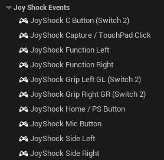

# Input

For inputs that have an XInput equivalent (e.g. face buttons, triggers and sticks), simply adding JoyShockLibrary4Unreal to your project and enabling it will make Unreal recognize those inputs automatically for any compatible controller, with no code changes required.

For buttons that are exclusive to JoyShock inputs, new input events have been added:

The Switch 2 Pro Controller's exclusive buttons also have their own input events: **JoyShock C Button (Switch 2)**, **JoyShock Grip Left GL (Switch 2)** and **JoyShock Grip Right GR (Switch 2)**.

## Joy-Con grips and stick conventions

A standalone Joy-Con is presented in Nintendo's solo-horizontal grip: its stick is rotated into the
physical horizontal orientation and exposed as Unreal's standard left stick; its four front buttons become
positional face buttons; SL/SR become the standard left/right shoulders; and the inaccessible outer
L/ZL or R/ZR buttons do not generate gameplay input. Its motion is turned the same way; see
[Sideways Joy-Cons](motion.md#sideways-joy-cons).

When a left and right half are joined they return to
vertical presentation, with the left half supplying Unreal's left stick and the right half its right stick.
Direct `JSL4U` state getters retain the native hardware fields; only engine-facing gamepad keys are adapted.
In particular, the Joy-Con R's native inverted vertical stick axis is normalised before its horizontal or
joined presentation, and DualShock 4 right-stick Y receives its engine-facing correction without changing
the direct getter. Shared Enhanced Input modifiers such as **To World Space** therefore receive the same
local X/Y convention from Joy-Cons, DualShock/DualSense and Pro Controllers; no per-device modifier is
needed in the Mapping Context.
Therefore a normal movement Mapping Context should bind only `Gamepad Left 2D` — do not also bind
`Gamepad Right 2D` to movement, because that would make a full controller's camera stick and right-stick
drift move the Pawn.

## Touchpad

The DualShock 4 and DualSense touchpad is exposed as **gamepad axes**, not as screen touches, so Enhanced
Input binds it exactly like a thumbstick:

| Key | Type |
| --- | --- |
| **JoyShock TouchPad 1 2D-Axis** | Axis2D — one finger's position in a single Vector2D |
| **JoyShock TouchPad 1 X-Axis** / **Y-Axis** | the components, if you want them separately |
| **JoyShock TouchPad 1 Touched** | button — down while a finger is on the pad |
| **JoyShock TouchPad 2 …** | the same four for the second finger |
| **JoyShock Capture / TouchPad Click** | the physical click, which is a separate button on the hardware |

Values are centred like a stick: `(0, 0)` is the middle of the pad, X runs left to right and Y runs bottom
to top, matching the sticks so a shared mapping (**To World Space** included) behaves the same on both. A
finger that is not down reads `(0, 0)`, which is why **Touched** exists — a corner-relative `0..1` range
could not tell "no finger" from "finger at the top-left corner".

Unreal's built-in **Touch 1 … Touch 10** keys are *not* the ones to use here, even though they are the
first place most people look. Those are touchscreen keys, fed by Slate's pointer pipeline, and a
controller touchpad has no screen position to give them; worse, a synthesised pointer press moves that
player's Slate focus to whatever widget it lands on, which takes their controller's input away from the
game viewport entirely. A touchpad belongs to one player's gamepad, so it is registered as one.

For games that genuinely want the pad driving Slate touch, `JoyShock.Touchpad.EmulateScreenTouch 1`
restores that behaviour. It is off by default, for the reason above.

## Native input-device metadata

Every connection is registered with Unreal's `FInputDeviceRegistry`, and the plugin supplies the same `Config/Input.ini` hardware metadata pattern used by the engine's XInput and WinDualShock plugins. `UInputDeviceSubsystem` therefore sees these as standard **Gamepad** devices with stable identifiers:

- `DualShock4`, `DualSense`
- `JoyConLeft`, `JoyConRight`
- `SwitchProController`, `Switch2ProController`
- `JoyShockGamepad` as the unknown-device fallback

The identifier describes the model; `InputDeviceId` describes one physical connection. Do not parse the display name to identify hardware, and do not persist `InputDeviceId` or `ConnectionId` between game runs.
