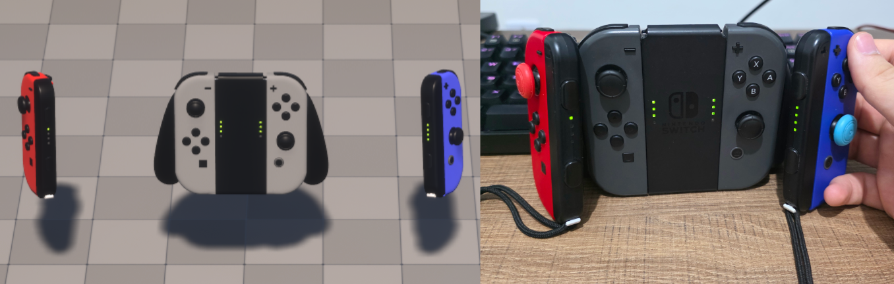

# Rumble, lights and output

## Rumble

Every controller this plugin drives can rumble, and there are two ways to drive it.

### Force feedback — the usual way

These controllers work with **Unreal's own force feedback**. `Play Force Feedback Effect`, `Client Play
Force Feedback` and Enhanced Input's force feedback effects drive them exactly as they drive an Xbox pad,
so authored effects with curves, falloff and looping work, and one code path serves every gamepad. Nothing
to enable.

The channels map the way Unreal's XInput interface reads them: `LeftLarge` drives the heavy,
low-frequency motor and `RightSmall` the light, high-frequency one. An effect is aimed at a *player*, so
both halves of a joined Joy-Con pair rumble together. `Force Feedback Scale` and `b Force Feedback
Enabled` on the PlayerController apply as usual.

### Direct rumble — one controller

**JSL4U Set Controller Rumble** (`ConnectionId`, `SmallRumble`, `BigRumble`) sets each motor from 0 to 1;
`(0, 0)` stops it. Use it for what force feedback cannot do, because force feedback is aimed at a player
rather than a controller:

- rumbling **one specific controller** — only the left half of a joined pair, say;
- rumbling a controller **not assigned to any player**, so an assignment screen can say "feel which
  controller this is" before players exist;
- holding a constant intensity without authoring a looping asset.

The two ways are independent: each motor runs at whichever of the two is stronger, and neither cancels
the other. Both reach the same maximum, so an effect that feels weak is a weak curve in the asset, not a
limit here. **Stop All Controller Rumble**, on the JoyShock Subsystem, stops every controller at once, and
runs by itself when the game shuts down.

### Per controller

| Controller | Rumble | Worth knowing |
|---|---|---|
| DualShock 4, DualSense | Two motors, small and big | |
| Joy-Con, Pro Controller | HD rumble: `BigRumble` is the low-frequency component (heavy shake), `SmallRumble` the high-frequency one (fine buzz) | Sustained until you set `(0, 0)` |
| Pro Controller 2, Joy-Con 2 | HD rumble, the same split | Sustained until `(0, 0)`, over USB and Bluetooth. Close Steam for it over USB — see [Conflicts](#conflicts-with-other-applications) |

## Lights

| Controller | Player indicator | Colour light | HOME light |
|---|---|---|---|
| Joy-Con, Pro Controller | Four LEDs, Nintendo's patterns for players 1-8 | — | Joy-Con R and Pro Controller |
| Pro Controller 2, Joy-Con 2 | Four LEDs, the same patterns | — | — |
| DualSense | Its five native player patterns | Light bar | — |
| DualShock 4 | — | Light bar | — |

**The player indicator follows Unreal's assignment by itself,** and both halves of a joined pair show the
same player. **JSL4U Set Player Indicator** overrides the number shown until the next assignment change. On
a DualShock 4, which has no numeric indicator, it does nothing.

**JSL4U Set Light Color** sets the DualShock 4 and DualSense light bar.

**The HOME light** is Nintendo's blue notification light, not a player number. A controller can keep it lit
from firmware or a previous console, so the plugin switches it off once each connection starts. A game
that wants it as a feedback channel takes it with **JSL4U Set Home Light**, and from then on the plugin
leaves it alone on that controller.

## Conflicts with other applications

Steam Input, DS4Windows and similar tools can hold a controller's output while input keeps flowing, so
rumble or player LEDs stop working with nothing to explain why. **Wait For Controller Function Blocked**
fires when an output is rejected while the controller is still delivering input, naming what is affected:
`Rumble`, `Player Indicator`, `Home Light` or `Motion Sensor`. It fires once per function until that function
works again, and only when the game actually uses it.

Only failures the system reports can be detected this way. An application that swallows output without
failing the write cannot be told apart from one that is not running.

**Steam and the Pro Controller 2 over USB.** Steam holds the controller's USB command interface for itself,
which blocks the plugin's set-up and rumble. Close Steam while using it; the plugin logs a warning and takes
the interface back once Steam closes. Rumble also has a fallback that works without that interface, and
Bluetooth is not affected.
