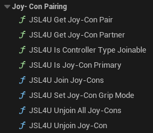

# Players and local multiplayer

How to create the players themselves is in [Getting started](getting-started.md#level-3-local-multiplayer).
This page is about which controller ends up on which player.

## Player slots

- **A controller keeps its slot for as long as it stays connected.** A disconnect leaves a hole instead of
  shifting the others down, so if player 1's controller drops mid-match, players 2 and 3 stay on their own
  characters. The next controller to connect fills the hole.
- **Slots follow the order controllers were switched on.** A controller that connected second stays on
  slot 1 even once it is the only one left — which in a single-player game means its input goes to a
  player that does not exist. **JSL4U Assign Controller To Player Index** is the only thing that overrides
  this.
- **Slots held by an XInput pad are skipped,** so these controllers land where a second Xbox pad would.
  An Xbox pad and a DualShock 4 give players 1 and 2, the same as two Xbox pads — one assignment scheme for
  both. The flip side is XInput's own behaviour: in a single-player game, the second controller drives a
  player that does not exist, exactly as a second Xbox pad would.
- **A slot can be shared.** Assign two, three or four controllers to the same slot and they all drive that
  player — a DualSense and a Pro Controller on one slot both move the same Pawn. A joined Joy-Con pair is
  the case the plugin performs for you.

Four solo Joy-Cons make four players; two joined pairs make two. A join dissolves by itself if either half
disconnects.

### Assignment nodes

| Node | What it does |
|---|---|
| **JSL4U Assign Controller To Player Index** | Puts a controller on a chosen slot; -1 hands it back to automatic assignment. Works for XInput pads too |
| **JSL4U Assign Controller To Player** | The same, addressed by Player Controller |
| **JSL4U Get Controllers Assigned To Player** | Every controller feeding a player, XInput pads included. Takes the generic `Controller`, so a Pawn's Possessed event plugs straight in. Two entries for a joined pair |
| **Ensure Local Player For Controller** (subsystem) | Reuses or creates the controller's Local Player and returns its Player Controller |

There is no node for reading a slot back: every controller info already carries **Player Index**, for
XInput pads as readily as for ours.

## More than four players

Unreal caps local players at **4** by default, and a fifth controller silently gets no player: it
connects, is reported, is given slot 4, and `Create Player` refuses it. The cap lives on the game viewport
as `MaxSplitscreenPlayers` — a misleading name, since it caps `Create Player` whether or not the screen is
ever split, even with **Set Force Disable Splitscreen** on.

There are two ways to raise it, and both change the same value:

| Way | How |
|---|---|
| Unreal's own | `MaxSplitscreenPlayers` in the project's `Config/DefaultEngine.ini`, below |
| This plugin's | **JSL4U Set Max Local Players**, from `BeginPlay`, before creating any player. Keeps the limit in the Blueprint that creates the players. **JSL4U Get Max Local Players** reads it back |

```ini
[/Script/Engine.GameViewportClient]
MaxSplitscreenPlayers=6
```

Either way, place as many `PlayerStart` actors as the players you allow.

## Combining Joy-Cons into one player

A left and a right Joy-Con can act as one upright controller for one player. Grip changes follow the
Switch convention:

| To | Do |
|---|---|
| Use a Joy-Con alone | Nothing: a Joy-Con connected by itself starts sideways, as its own controller |
| Join two halves | Hold **L or ZL** on the left and **R or ZR** on the right at the same time — **ZL + ZR** is enough. These buttons are held back until released, so the join does not also fire gameplay actions |
| Separate a pair | Press **SL + SR** on either half; both become sideways controllers again |

When several pairs do the chord in the same frame, device-id order pairs them, the same way every time.
Both generations of Joy-Con join the same way.



| Node | What it does |
|---|---|
| **JSL4U Join Joy-Cons** (A, B) | Joins a left and a right Joy-Con into one upright controller: the left half is the left stick and its buttons, the right half the right stick and its buttons |
| **JSL4U Unjoin Joy-Con** / **JSL4U Unjoin All Joy-Cons** | Separate one pair, or all of them; each half goes back to sideways |
| **JSL4U Set Joy-Con Grip Mode** | Horizontal or Vertical for one half. Vertical suits a game that uses one upright half, such as Just Dance; Horizontal on a joined half separates the pair |
| **JSL4U Get Joy-Con Pair** | From either half: whether it is joined, and both halves' infos, Primary first |
| **JSL4U Get Joy-Con Partner** | Whether this half is joined right now, and to which `ConnectionId` |
| **JSL4U Is Joy-Con Primary** | Whether this device represents its logical controller — always for a standalone one, for exactly one half of a pair |
| **JSL4U Is Controller Type Joinable** | Whether a controller type can be joined; Join Joy-Cons checks with this same function |

`Primary` names a *device*, not a *side*: which half leads depends on connection order, so a pair's
primary may be the right Joy-Con. Read `Controller Type` on the returned infos when something has to land
on a specific half.
